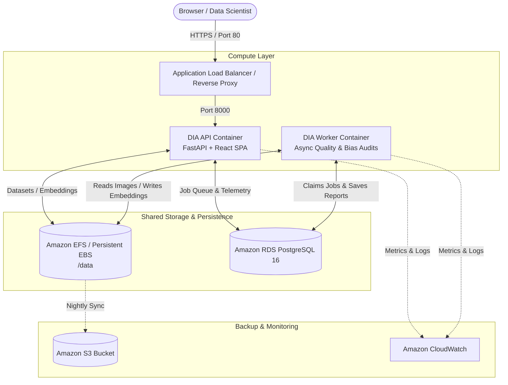

# Dataset Integrity Analyzer (DIA) 2.0 — AWS Production Deployment Guide

This guide details how to deploy the fully integrated Dataset Integrity Analyzer (DIA 2.0) — including the React Web Studio frontend, FastAPI backend, PostgreSQL database, and asynchronous analysis workers — onto Amazon Web Services (AWS).

---

## 1. System Architecture



### Key Architectural Highlights
1. **Single Entry Point**: The React Web Studio frontend is compiled directly into the container image and served by FastAPI. There are zero cross-origin (CORS) or proxy issues.
2. **Shared File Storage**: Both the API container (which extracts uploaded datasets) and the Worker container (which scans images, computes pHash, and runs ML models) mount `/data` via Amazon EFS or local EBS.
3. **Database-Backed Job Queue**: The PostgreSQL database (`JobQueue` table) coordinates work between the API and workers, featuring lease-based locking and automatic crash recovery.
4. **Health Check Telemetry**: The unauthenticated endpoint `GET /health` enables AWS Application Load Balancers and ECS Target Groups to instantly monitor service readiness.

---

## 2. Choosing Your AWS Deployment Path

| Deployment Option | Best For | Estimated Monthly Cost | Difficulty |
| :--- | :--- | :--- | :--- |
| **Option A: Amazon EC2** *(Recommended)* | Small to mid-size teams, startups, fast setups | ~$30 – $70/mo (`t3.large` or `c6i.large`) | **Easiest** (1 Command) |
| **Option B: ECS Fargate + RDS + EFS** | Enterprise compliance, auto-scaling, high availability | ~$120 – $250/mo | **Intermediate** (CloudFormation) |
| **Option C: AWS App Runner** | Serverless single-container deployments | Pay-per-request / ~$25 – $60/mo | **Easy** |

---

## 3. Option A: Automated Amazon EC2 Deployment (Recommended)

This is the fastest, most reliable, and cost-efficient method. A single script sets up Docker, systemd auto-restart, secrets, and starts the full-stack system.

### Step 1: Launch an EC2 Instance
1. In the AWS Console, navigate to **EC2** > **Launch Instance**.
2. **Name**: `dia-analyzer-server`
3. **AMI**: **Amazon Linux 2023** or **Ubuntu 24.04 LTS**.
4. **Instance Type**:
   - Minimum: `t3.medium` (2 vCPU, 4 GB RAM)
   - **Recommended Production**: `t3.large` (2 vCPU, 8 GB RAM) or `c6i.xlarge` (4 vCPU, 8 GB RAM) for fast image processing.
5. **Storage**: At least **40 GB – 100 GB gp3 SSD** (to store uploaded datasets and embeddings).
6. **Security Group Inbound Rules**:
   - `SSH` (Port 22) from your IP.
   - `HTTP` (Port 80) from `0.0.0.0/0`.
   - `Custom TCP` (Port 8000) from `0.0.0.0/0`.
   - `HTTPS` (Port 443) from `0.0.0.0/0` (if configuring SSL).

### Step 2: Connect to your Instance & Deploy
Connect via SSH or EC2 Instance Connect, then run:

```bash
# 1. Clone repository
git clone https://github.com/srijan-bajpai/dataset-integrity-analyzer.git /opt/dia
cd /opt/dia

# 2. Run the automated deployment script
sudo bash aws/deploy-ec2.sh
```

### What the Script Does Automatically:
- Installs Docker Engine and the Docker Compose plugin.
- Generates strong cryptographically secure passwords in `/opt/dia/.env`.
- Creates a `systemd` service (`dia.service`) so DIA boots automatically on instance restarts.
- Compiles the React Web Studio frontend and Python backend into Docker images.
- Starts PostgreSQL, FastAPI, and the background worker.
- Verifies the `/health` endpoint and prints your live Web Studio URL!

### Step 3: Access the Studio
Open your browser and navigate to:
```
http://<your-ec2-public-ip>:8000
```
- When prompted, enter the **Studio Password** output by the setup script (or inspect `cat /opt/dia/.env | grep DIA_SHARED_PASSWORD`).
- Upload a ZIP dataset, configure targets, and view full 3D interactive integrity audits!

---

## 4. Option B: Enterprise Serverless (AWS ECS Fargate + RDS + EFS)

For organizations requiring zero host maintenance, AWS managed databases, encrypted EFS storage, and an Application Load Balancer.

### Step 1: Push Container to Amazon ECR
```bash
# 1. Authenticate Docker with Amazon ECR
aws ecr get-login-password --region us-east-1 | docker login --username AWS --password-stdin <aws-account-id>.dkr.ecr.us-east-1.amazonaws.com

# 2. Create ECR repository (if not exists)
aws ecr create-repository --repository-name dia-analyzer --region us-east-1

# 3. Build and tag the production multi-stage image
docker build -t dia-analyzer .
docker tag dia-analyzer:latest <aws-account-id>.dkr.ecr.us-east-1.amazonaws.com/dia-analyzer:latest

# 4. Push image
docker push <aws-account-id>.dkr.ecr.us-east-1.amazonaws.com/dia-analyzer:latest
```

### Step 2: Deploy CloudFormation Stack
Use the provided `aws/cloudformation.yaml` template:

```bash
aws cloudformation create-stack \
  --stack-name dia-production \
  --template-body file://aws/cloudformation.yaml \
  --capabilities CAPABILITY_IAM \
  --parameters \
      ParameterKey=ContainerImage,ParameterValue=<aws-account-id>.dkr.ecr.us-east-1.amazonaws.com/dia-analyzer:latest \
      ParameterKey=DiaSharedPassword,ParameterValue="MySecureStudioPass123!" \
      ParameterKey=DatabasePassword,ParameterValue="MyDbPostgresPass123!" \
      ParameterKey=DatabaseInstanceClass,ParameterValue="db.t4g.micro" \
      ParameterKey=ApiTaskCpu,ParameterValue="1024" \
      ParameterKey=ApiTaskMemory,ParameterValue="2048" \
      ParameterKey=WorkerTaskCpu,ParameterValue="2048" \
      ParameterKey=WorkerTaskMemory,ParameterValue="4096"
```

### Step 3: Access your Load Balancer
Once CloudFormation finishes (Status: `CREATE_COMPLETE`):
```bash
aws cloudformation describe-stacks --stack-name dia-production --query "Stacks[0].Outputs"
```
Open the `WebStudioURL` from the output in your browser!

---

## 5. Environment Variables Reference

| Variable | Default | Purpose |
| :--- | :--- | :--- |
| `DIA_SHARED_PASSWORD` | *(Required in prod)* | Password required to unlock Studio, upload data, and run audits |
| `DIA_DATABASE_URL` | `sqlite:///dia_v2.db` | SQLAlchemy connection string (`postgresql+psycopg2://...`) |
| `DIA_STORAGE_DIR` | `/data` | Path where uploads, extracted images, and embeddings are stored |
| `DIA_ENV` | `production` | Set to `production` or `development` |
| `DIA_CORS_ORIGINS` | `*` | Allowed CORS origins (e.g. `*` or `https://dia.company.com`) |
| `DIA_MAX_SAMPLES` | `2000` | Sample cap per dataset audit (safeguards memory and CPU) |
| `DIA_MAX_UPLOAD_MB` | `200` | Max compressed ZIP upload size |
| `DIA_MAX_EXTRACTED_MB`| `500` | Max uncompressed extracted size |
| `DIA_WORKER_POLL_SECONDS`| `2` | Polling frequency for pending audit jobs |
| `PORT` | `8000` | Listening port for the application |

---

## 6. S3 Dataset Sync & Disaster Recovery

To archive datasets and embeddings to an Amazon S3 bucket, use `aws/s3-sync.sh`:

```bash
# 1. Back up all datasets, uncompressed images, and embeddings to S3
sudo bash aws/s3-sync.sh backup my-dia-backup-bucket

# 2. Restore to a new machine or instance
sudo bash aws/s3-sync.sh restore my-dia-backup-bucket
```

### Automated Nightly Cron
To automate backups every night at 2:00 AM:
```bash
(crontab -l 2>/dev/null; echo "0 2 * * * /opt/dia/aws/s3-sync.sh backup my-dia-backup-bucket > /var/log/dia-s3-backup.log 2>&1") | crontab -
```

---

## 7. Operations & Monitoring

### Viewing Real-Time Logs
- On EC2:
  ```bash
  cd /opt/dia
  docker compose logs -f api       # Web studio & API access logs
  docker compose logs -f worker    # Background analysis logs
  ```
- On ECS Fargate:
  View CloudWatch log streams under `/ecs/dia-production-api` and `/ecs/dia-production-worker`.

### Managing the EC2 Service
```bash
sudo systemctl status dia    # Check status
sudo systemctl restart dia   # Restart all containers
sudo systemctl stop dia      # Stop service
```

### Health Check Monitoring
Add `http://<domain-or-ip>:8000/health` to AWS Route 53 Health Checks, Datadog, or UptimeRobot. A healthy system responds with:
```json
{"status": "ok", "version": "2.0.0"}
```
